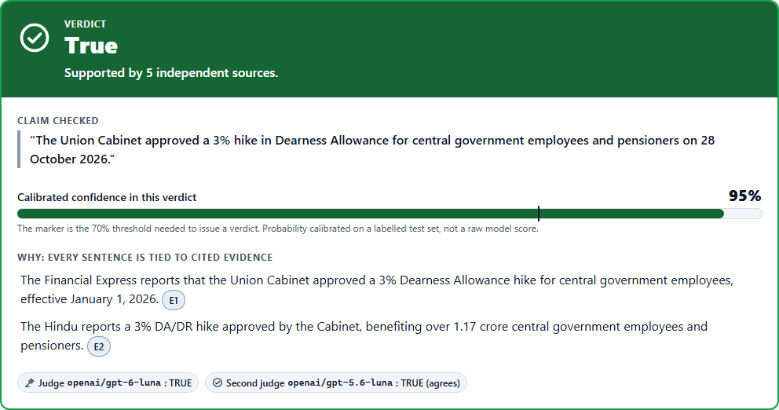
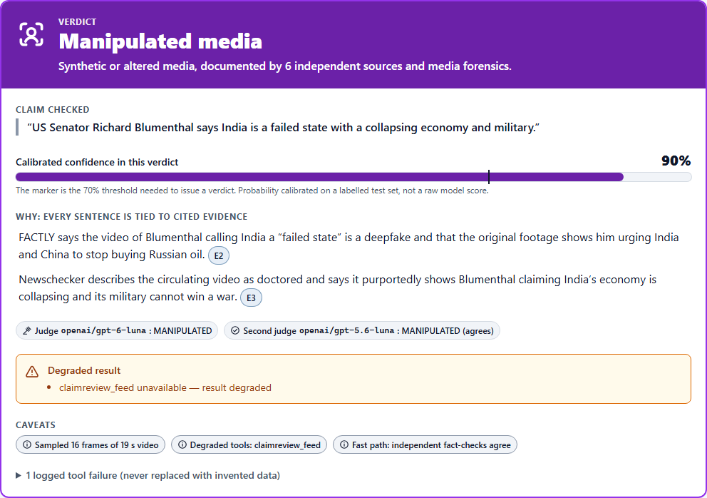
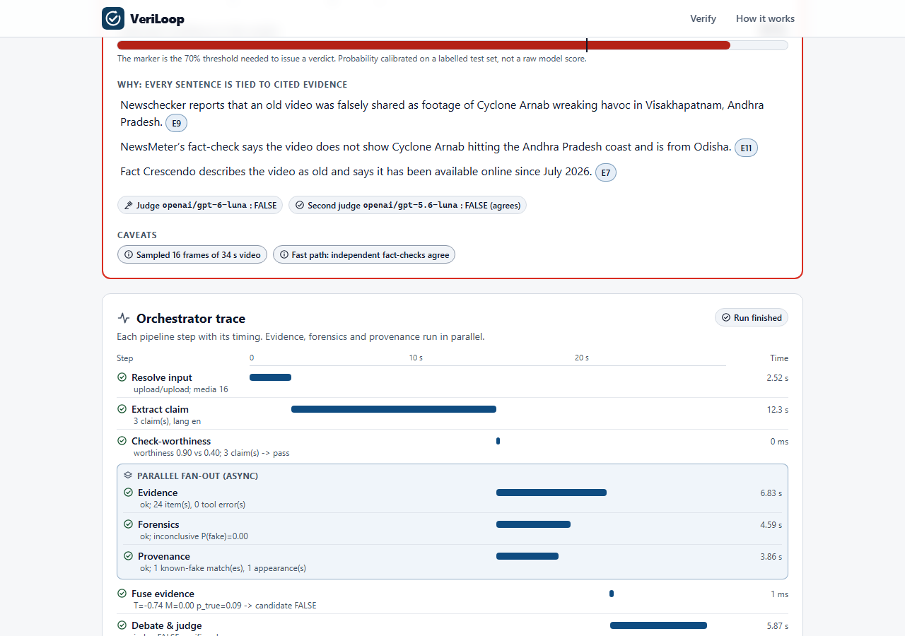
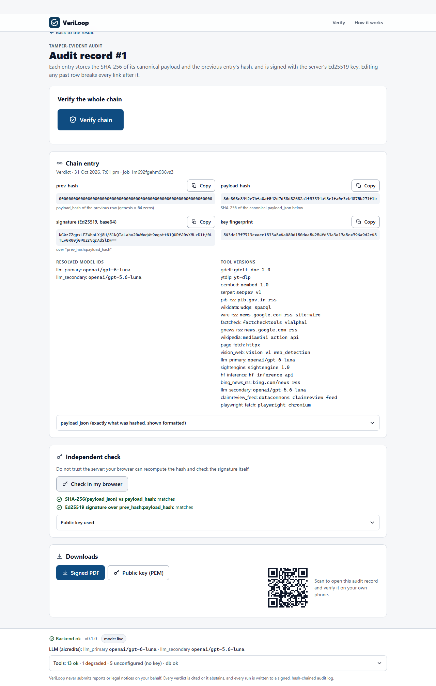
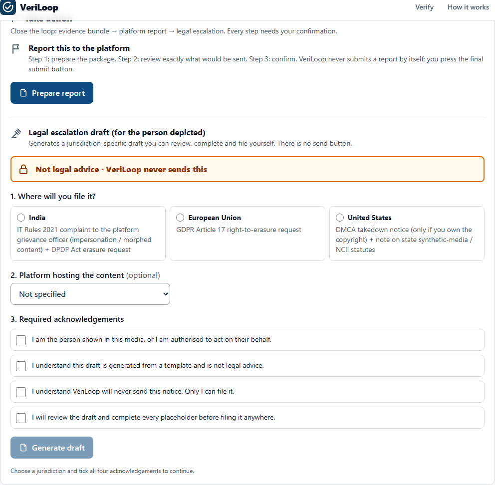
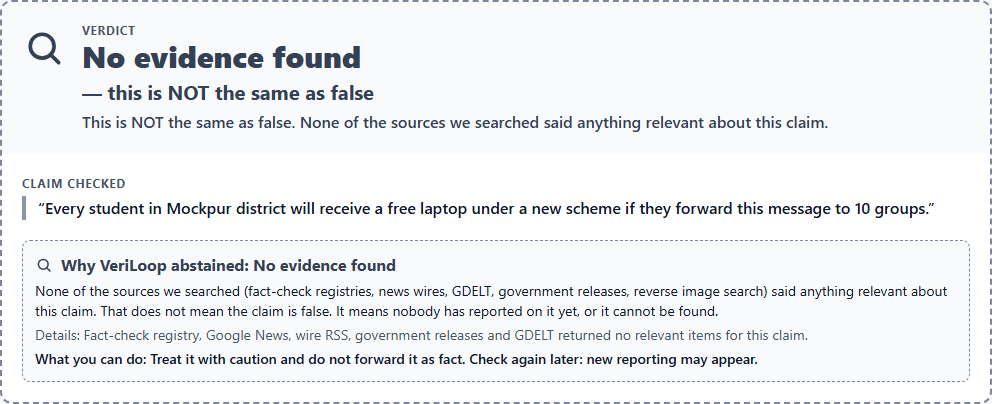
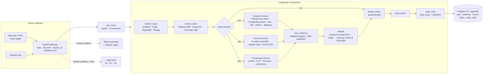

# VeriLoop

**Agentic fact verification and deepfake audit that doesn't stop at detection.**
Civic Pulse / Digital Governance & Public Information track (hackathon prototype).

Paste a social-media link, upload a clip, or forward a message. VeriLoop extracts the claim (speech,
caption, on-screen text) and checks it in parallel against fact-check registries, wire and government
news, Wikidata, and open forensic models. It then returns a **calibrated verdict with citations, or
explicitly abstains**. From there it closes the loop most tools leave open:

```
verdict ──► evidence bundle ──► platform report ──► legal escalation ──► tamper-evident audit
            (hashes + sources)  (pre-filled, human   (jurisdiction-aware   (hash-chained, Ed25519-
                                 presses submit)       draft, never sent)    signed PDF, live verify)
```

Every run writes a hash-chained, signed audit record you can verify on stage: `GET /audit/{id}/verify → ok:true`.
Edit one database row and the same endpoint reports exactly where the chain broke.

---

## Screenshots (live runs, real sources)

| TRUE with 5 independent sources | Deepfake → MANIPULATED |
|---|---|
|  |  |
| **Cited rationale + parallel orchestrator trace** | **Tamper-evident audit, verified in the browser** |
|  |  |
| **Report + legal escalation (never sent)** | **"No evidence" is not "false" (G8)** |
|  |  |

## What makes it different

| | Typical fact-check bot | VeriLoop |
|---|---|---|
| Output | A label | A label **plus** cited evidence, per-model forensic scores, provenance, node-level trace |
| When unsure | Guesses | **Abstains** with a reason code (`SINGLE_SOURCE`, `CONFLICT`, `FORENSIC_INCONCLUSIVE`, …) |
| "No evidence found" | Often shown as "false" | Shown as a visually distinct state (grey, dashed): **not the same as false** |
| After the verdict | Nothing | Evidence bundle → pre-filled platform report → legal draft → signed audit PDF |
| Trust | "Trust us" | Ed25519-signed hash chain; the browser re-checks the hash and signature itself |
| Without paid API keys | Doesn't run | **Runs fully keyless**; each paid integration switches on when its key is added |

## Architecture



* **Modular monolith** (one FastAPI process, one Postgres) with typed pydantic contracts
  (`backend/veriloop/contracts/`) shared by every service. Each service is independently tested.
* **True parallel branches.** Evidence, forensics and provenance run as parallel LangGraph edges; the
  trace shows them overlapping.
* **Resilience.** Every external call goes through one `ToolClient`, which provides per-tool timeouts,
  exponential-backoff retries, circuit breakers, secondary providers, caching, and fault injection
  (`POST /admin/chaos`). It can also record and replay responses so the demo works offline.

## AI reasoning

* **LLM provider:** [aicredits.in](https://aicredits.in) (OpenAI-compatible). Model ids are **resolved at
  boot** from the provider's `/models` listing against an allowlist. Nothing is hardcoded. A live auth
  probe makes startup fail fast on a bad key.
  * Resolved on 2026-10-31: primary **`openai/gpt-6-luna`**; independent second judge **`openai/gpt-5.6-luna`**.
  * The resolved ids are written into every audit record.
* **The LLM is never a source.** It reasons only over evidence fetched in that job. Every rationale
  sentence must cite evidence ids, and the verifier rejects anything else.
* **Multi-agent debate (Tool-MAD).**
  * A proponent and an opponent argue in parallel from different tool sets.
  * A judge rules.
  * A **dual-key verifier** checks every sentence deterministically (ids and URLs exist in this job),
    with an LLM support check, and with local multilingual NLI entailment.
  * A second model judges independently. If the two disagree, confidence is downgraded or the run abstains.
* **Fusion and calibration.** Weighted signals are combined: ClaimReview match, news stance across
  *independent* publisher groups, GDELT corroboration, Wikidata consistency, provenance, and forensics on
  a separate manipulation axis. Missing signals are excluded, never counted against the claim.
  Platt-calibrated on our own labelled set.
* **Guardrails enforced in code:**
  * at least 2 independent sources for any TRUE/FALSE/MANIPULATED verdict (syndicated copies count once);
  * the forensic abstain band;
  * a conflict rule;
  * extra caution for private individuals before a legal draft is offered.

## Works with zero keys

| Paid integration (auto-enabled when its key is in `.env`) | Keyless substitute that runs today |
|---|---|
| Google Fact Check Tools API | Local index of Google's public **ClaimReview feed** (~100k reviews, refreshed daily) + JSON-LD ClaimReview parsing of fact-check articles |
| Serper web search | Google News RSS + Bing News RSS + Wikipedia + GDELT + PIB |
| Google Cloud Vision web detection | Own **pHash + CLIP** known-fake index + LLM visual query expansion |
| Sightengine deepfake API | Local open-model ensemble |
| Telegram bot token | Bot code complete; idle until `TELEGRAM_BOT_TOKEN` is set |

`/health` lists each tool's state (`ok`, `unconfigured`, `open` for a tripped breaker, or `chaos`).

## Quick start (Windows dev box, no Docker)

Prerequisites: Python 3.12, [uv](https://docs.astral.sh/uv/), Node 20+, ffmpeg on PATH.

```bash
# 1. Backend deps (CPU-only torch)
uv venv --python 3.12 .venv
uv pip install --python .venv/Scripts/python.exe -e "backend[ml,dev,c2pa]" \
  --extra-index-url https://download.pytorch.org/whl/cpu --index-strategy unsafe-best-match
.venv/Scripts/python.exe -m playwright install chromium

# 2. Config: copy and fill in at least LLM_API_KEY (aicredits.in). Everything else is optional.
cp .env.example .env          # set VERILOOP_HOME to a drive with ~5 GB free

# 3. Frontend
cd frontend && npm install && npm run build && cd ..

# 4. One-time data
cd backend
python scripts/sync_claimreview.py --refresh   # ClaimReview feed -> Postgres (keyless fact-check index)
python scripts/seed_known_fakes.py             # known-fake pHash/CLIP index
python scripts/fetch_demo_media.py             # demo clips (cases b, c)

# 5. Run (embedded Postgres + pgvector starts automatically; no DB install needed)
python -m veriloop                             # http://localhost:8000
```

Production: `deploy/docker-compose.yml` (api + `pgvector/pgvector:pg16` + Caddy) on one VPS.

### Tests

```bash
cd backend && python -m pytest -q                 # unit tests, no network, no model downloads
python -m pytest -m network -q                    # live integrations (uses real keys / network)
cd ../frontend && npm test && npx tsc --noEmit    # frontend
python -m pytest reporter-agent/tests -q
```

## Measured results (our own small test sets; see D6)

**Forensics** (`scripts/eval_forensics.py` → `data/eval/forensics/results.json`). Test set:
`OpenRL/DeepFakeFace`, 60 real + 60 fake (face swaps, SD inpainting, SD text-to-image).

| model | AUC (original) | AUC (JPEG q30) |
|---|---|---|
| `dima806/deepfake_vs_real_image_detection` (face crops) | 0.543 | 0.508 |
| `prithivMLmods/Deep-Fake-Detector-v2-Model` (face crops) | 0.540 | 0.580 |
| `buildborderless/CommunityForensics-DeepfakeDet-ViT` (whole image) | **0.874** | 0.760 |
| **Ensemble with abstain band** | **0.808**; abstains on 70%; 77.8% accurate when it decides; **0 real images called manipulated** | abstains on 100% (E7 quality gate) |

The public face-swap detectors are near chance on this set, which is exactly why the abstain band exists
and why forensics alone can never produce a MANIPULATED verdict. Details: [docs/media.md](docs/media.md).

**Claim verification** (`scripts/calibrate.py` → `config/calibration.json`): Platt scaling fitted on the
train split of our 40-claim labelled set (`data/eval/claims.jsonl`), measured on the held-out test split.

| split | rows | coverage (emitted a verdict) | selective precision (emitted verdicts correct) | abstain rate |
|---|---|---|---|---|
| train | 24 | 75 % | **100 %** (18/18) | 25 % |
| test | 11 | 45 % | **100 %** (5/5) | 55 % |

Abstentions come mostly from the 2-independent-source rule. For example, several FALSE rows are rated
by only one fact-checker, so the system refuses rather than guesses. The test split is tiny, so treat
these numbers as indicative. Details: [docs/reasoning.md](docs/reasoning.md).

**End-to-end demo runs** (live server, real aicredits models, real sources, CPU-only laptop, 2026-10-31):

| case | input | verdict | confidence | time | audit verify |
|---|---|---|---|---|---|
| a | DA-hike text (4 runs) | **TRUE** ×4, 5 independent sources | 0.95 | 18–24 s | ✓ |
| b | Cyclone Arnab clip (upload) | **FALSE** (known-fake match + 3 fact-checks) | 0.91 | 28–36 s | ✓ |
| c | Blumenthal deepfake clip (upload) | **MANIPULATED**, legal draft offered | 0.90 | 27–35 s | ✓ |
| d | Pay Commission text | **UNVERIFIABLE** (SINGLE_SOURCE) | 0.68 | 6–11 s | ✓ |

Also checked live:
* `tamper_demo.py` → `ok:false, broken_at:22, "payload was modified"`, then `restore_chain.py` → `ok:true`;
* the legal draft without all 4 acknowledgements → HTTP 422;
* the browser's own SHA-256 and Ed25519 checks → "matches".

## Demo

Four scripted cases, all with real, verified sources ([docs/demo_cases.md](docs/demo_cases.md)):

| | Input | Expected |
|---|---|---|
| a | "Union Cabinet approved a 3% DA hike… 28 October 2026" | **TRUE**, cited by PIB + independent outlets |
| b | Typhoon Bavi footage shared as "Cyclone Arnab hitting Visakhapatnam" | **FALSE** + report package |
| c | Deepfake video of US Senator Richard Blumenthal | **MANIPULATED** + legal draft (never sent) |
| d | "8th Pay Commission will recommend a 2.86 fitment factor" | **UNVERIFIABLE** (abstain) |

Stage script: [DEMO_SCRIPT.md](DEMO_SCRIPT.md). It also covers the live tool-outage switch and the audit
tamper/verify moment. Rubric mapping: [RUBRIC_MAP.md](RUBRIC_MAP.md). Design decisions: [DECISIONS.md](DECISIONS.md).

## Repository map

```
backend/veriloop/
  contracts/        typed pydantic contracts (single source of truth for every service + the UI)
  core/             config, ToolClient (retry/breaker/chaos/cassettes), aicredits LLM client, ML (e5, NLI)
  db/               schema.sql (append-only audit trigger, pgvector), embedded Postgres bootstrap, repo
  orchestrator/     LangGraph graph, traced nodes, job runner, JobView
  services/         ingestion · extraction · evidence · provenance · forensic · fusion · debate
                    audit · reporting · legal
  api/              FastAPI app, routes, middleware, SPA serving
  bots/telegram/    aiogram bot with 24 h TTL + HMAC'd chat ids
backend/scripts/    sync_claimreview · seed_known_fakes · fetch_demo_media · eval_forensics ·
                    calibrate · record_demo · tamper_demo · restore_chain
frontend/           React 19 + Vite + Tailwind PWA (share target, live trace, verdict states)
reporter-agent/     presenter-side Playwright helper: pre-fills platform report forms, never submits
data/               eval sets, known-fake manifest, source lists (satire, state media, fact-checkers…)
docs/               SPEC, BUILD_SPEC, per-area design docs, research notes, demo cases
deploy/             Dockerfile, docker-compose (api + pgvector + Caddy), Caddyfile
```

## Guardrails → where they live

| Rule | Enforcement |
|---|---|
| G1/G4/D5 no verdict without ≥ 2 independent citations | `services/fusion` final gate; syndication groups in `data/lists/syndication.json` |
| G2 low confidence → UNVERIFIABLE | `ABSTAIN_THRESHOLD` + Platt calibration |
| G3 no silent fabricated fallback | `core/tool_client.py`: every failure becomes a logged `ToolError` and a branch status |
| G5/D4 no auto-submission | Graph never runs report/legal; API needs explicit confirm + 4 acks; reporter-agent stops before Submit |
| G6/D7 Telegram TTL | `ephemeral_inputs` + purge loop; audit stores only hashes for Telegram jobs |
| G7 model ids + tool versions in every audit row | `services/audit` payload |
| G8 "no evidence" ≠ "false" | `EvidenceState.NO_EVIDENCE` vs `REFUTES`; distinct UI state |
| G9 private individuals | Legal eligibility requires forensic MANIPULATED + ≥ 2 manipulation sources |
| D1 no hardcoded model ids | `core/model_registry.py` runtime resolution + allowlist |

## Status and known limitations

* **Latency** is above the spec targets (text < 5 s, video < 20 s): text claims take 18–24 s and videos
  27–36 s on this CPU-only laptop. Four LLM round trips are inherent to the debate design (stance →
  proponent ∥ opponent → judge → verifier ∥ second judge), and on-device ASR/OCR dominates video. Cheap
  abstains (case d) finish in 6–11 s. Options and trade-offs are in `docs/reasoning.md` §6.
* The local ClaimReview search can exceed its 4 s budget under CPU load. It is then reported as a
  degraded tool and never replaced with invented data, and the news and fact-check sources still decide the case.
* The face-swap detectors are weak (measured above). There is no synthetic-speech detector yet.
* Without a Cloud Vision key, provenance finds re-uploads of *indexed* media but not the original of new media.
* reporter-agent selectors haven't been run against logged-in platform accounts. If a selector fails,
  it falls back to deep links and written steps.
* The Telegram bot has not been run live (it needs a BotFather token).
* Legal templates cite IT Rules 2021, the DPDP Act 2023, GDPR Art. 17, DMCA §512 and the TAKE IT DOWN Act.
  **They are drafts, not legal advice; verify the provisions with a lawyer.**

## Docs

[SPEC](docs/SPEC.md) · [BUILD_SPEC](docs/BUILD_SPEC.md) · [foundation](docs/foundation.md) ·
[media](docs/media.md) · [reasoning](docs/reasoning.md) · [actions](docs/actions.md) · [API](docs/api.md) ·
[frontend](docs/frontend.md) · [research](docs/research.md) · [demo cases](docs/demo_cases.md)
